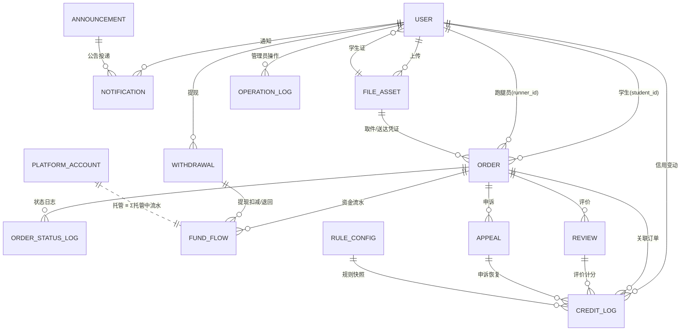

# 数据库设计文档

- 数据库：MySQL 8.0（`utf8mb4` / `utf8mb4_unicode_ci`）
- 业务表 **14 张**；框架表（auth / admin / sessions / token_blacklist / cache_table）不计入
- 金额一律 `DECIMAL(10,2)`（人民币元，两位小数，后端全程 `Decimal`，禁用 float）
- 时间一律 `DATETIME`（`Asia/Shanghai`，Django `USE_TZ=True`）
- 所有业务表含 `created_at` / `updated_at`；业务数据只做逻辑删除/状态禁用，不物理删除

## 1. ER 图

> 表名映射：`USER=accounts_user`、`ORDER=orders_order`、`ORDER_STATUS_LOG=orders_orderstatuslog`、
> `REVIEW=orders_review`、`APPEAL=orders_appeal`、`FUND_FLOW=finance_fundflow`、`WITHDRAWAL=finance_withdrawal`、
> `PLATFORM_ACCOUNT=finance_platformaccount`、`CREDIT_LOG=credit_creditlog`、`RULE_CONFIG=common_ruleconfig`、
> `NOTIFICATION=common_notification`、`ANNOUNCEMENT=common_announcement`、`OPERATION_LOG=common_operationlog`、
> `FILE_ASSET=common_fileasset`

## 2. 数据字典

### 2.1 `accounts_user` 用户表（合并跑腿员档案与认证）

| 字段 | 类型 | 说明 |
|------|------|------|
| id | BIGINT PK | |
| username | VARCHAR(150) UNIQUE | 登录账号（学号），同时作为演示登录名 |
| password | VARCHAR(128) | Django PBKDF2 哈希 |
| name | VARCHAR(50) | 姓名 |
| student_no | VARCHAR(32) IDX | 学号（唯一性由业务层校验，因管理员账号可空） |
| role | VARCHAR(16) | `user` / `admin` |
| admin_level | VARCHAR(16) | `none` / `operator` / `super_admin` |
| is_runner | BOOL | **派生字段** =(cert_status == approved)，后端同事务维护 |
| runner_balance | DECIMAL(10,2) | 可提现余额，恒 ≥ 0 |
| credit_score | INT | 信用分，区间 [0,150]，初始 100 |
| banned | BOOL | 封禁标记（封禁同时 `is_active=False` 与拉黑 JWT） |
| ban_reason | VARCHAR(200) | 封禁原因 |
| cert_status | VARCHAR(16) | `none` / `pending` / `approved` / `rejected` |
| cert_reject_reason | VARCHAR(200) | 驳回原因（可改资料重新申请） |
| card_file_id | BIGINT FK→file_asset | 学生证图片（仅本人与管理员可见） |
| cert_reviewed_by_id / cert_reviewed_at | BIGINT / DATETIME | 审核人与时间 |
| completed_count | INT | 完成单数（作为跑腿员） |
| good_reviews / review_count | INT | 好评数与评价总数（好评率 = 比值） |
| created_at / updated_at | DATETIME | 审计字段 |

索引：`(role,banned)`、`(cert_status)`、`(student_no)`

### 2.2 `orders_order` 订单表（需求与订单合一）

| 字段 | 类型 | 说明 |
|------|------|------|
| order_no | VARCHAR(32) UNIQUE | 订单号 = `yyyyMMdd` + 8 位随机数字，冲突重试 ≤3 次 |
| student_id | BIGINT FK→user | 发单学生 |
| runner_id | BIGINT FK→user NULL | 接单跑腿员 |
| description | VARCHAR(500) | 任务描述 |
| pickup_address / delivery_address | VARCHAR(200) | 取件/送达地址（纯文字，不做地图） |
| time_window_start / time_window_end | DATETIME | 时间窗口 |
| runner_fee | DECIMAL(10,2) | 跑腿费 |
| item_fee_mode | VARCHAR(16) | `none`(纯跑腿) / `offline`(线下付) / `platform`(平台代付) |
| item_fee_estimate | DECIMAL(10,2) | 物品预估费（仅代付模式入账） |
| actual_item_fee | DECIMAL(10,2) NULL | 实际物品费（送达打卡填写） |
| prepaid | BOOL | 垫付状态：代付模式取件打卡即置真 |
| final_reward | DECIMAL(10,2) NULL | 最终酬金 = 跑腿费 + min(实际物品费, 预估费) |
| status | VARCHAR(24) IDX | 见 §3 状态枚举 |
| prev_status | VARCHAR(24) | 占位态（申诉中/异常）进入前的快照 |
| settle_status | VARCHAR(16) | `none` / `settled` / `refunded` / `partial` |
| cancel_reason / cancel_by_id | VARCHAR(200) / FK | 取消原因与发起人 |
| paid_at / accept_at / pickup_at / deliver_at / completed_at | DATETIME | 各节点时间 |
| auto_confirm_deadline | DATETIME | 自动确认截止（送达后按规则计算） |
| review_deadline | DATETIME | 评价截止（完成后 +7 天，逾期视为放弃） |
| no_show_warned_at | DATETIME | 未取件提醒时间（幂等标记） |
| pickup_file_id / deliver_file_id | FK→file_asset | 取件/送达凭证 |

索引：`(status,created_at)`、`(student_id,status)`、`(runner_id,status)`

### 2.3 `orders_orderstatuslog` 订单状态日志表

| 字段 | 类型 | 说明 |
|------|------|------|
| order_id | FK→order | 所属订单 |
| from_status / to_status | VARCHAR(24) | 原状态 / 新状态 |
| operator_id | FK→user NULL | 操作人（NULL = 系统） |
| remark | VARCHAR(200) | 备注（含资金动作说明） |
| created_at | DATETIME | 发生时间 |

### 2.4 `finance_fundflow` 资金流水表（六类动作合一）

| 字段 | 类型 | 说明 |
|------|------|------|
| flow_no | VARCHAR(32) UNIQUE | 流水号 `FL`+日期+随机 |
| order_id | FK→order NULL | 关联订单（提现流水为空） |
| user_id | FK→user NULL | 关联用户 |
| withdrawal_id | FK→withdrawal NULL | 关联提现 |
| amount | DECIMAL(10,2) | 金额 |
| direction | VARCHAR(8) | `in` 入 / `out` 出 |
| type | VARCHAR(20) IDX | `pay` / `escrow` / `settle` / `refund` / `withdraw` / `withdraw_return` |
| status | VARCHAR(16) | 见 §3 类型×状态对照 |
| runner_fee_part / item_fee_part | DECIMAL(10,2) | **费用构成**（跑腿费 / 物品费），双维度过滤用 |
| balance_after | DECIMAL(12,2) | 变动后余额快照（托管账户余额或用户余额） |
| idem_key | VARCHAR(80) **UNIQUE** | 幂等键（防重复支付/结算/提现） |
| external_no | VARCHAR(40) | 平台模拟单号 |
| channel | VARCHAR(32) | 固定「平台模拟」 |
| remark | VARCHAR(200) | 备注 |
| created_at / updated_at | DATETIME | |

索引：`(order_id,type)`、`(user_id,type)`、`(created_at)`

### 2.5 `finance_withdrawal` 提现记录表

| 字段 | 类型 | 说明 |
|------|------|------|
| runner_id | FK→user | 提现跑腿员 |
| amount | DECIMAL(10,2) | 提现金额 |
| balance_before / balance_after | DECIMAL(10,2) | 申请时余额快照与扣减后余额 |
| status | VARCHAR(16) IDX | `pending` / `approved` / `rejected` |
| method / account | VARCHAR(32) / VARCHAR(64) | 收款方式与账号（模拟字段，不建表） |
| reject_reason | VARCHAR(200) | 驳回原因（同时回滚余额） |
| flow_no | VARCHAR(32) | 关联资金流水号 |
| handler_id / handled_at | FK / DATETIME | 处理人与时间 |

### 2.6 `orders_review` 评价表（双向互评）

| 字段 | 类型 | 说明 |
|------|------|------|
| order_id / reviewer_id / reviewee_id | FK | 订单 / 评价人 / 被评价人 |
| score | SMALLINT | 星级 1–5（4–5 好评、1–2 差评、3 中评） |
| content | VARCHAR(500) | 评价内容 |

约束：`UNIQUE(order_id, reviewer_id)`（一单每人一条）；索引 `(reviewee_id,created_at)`

### 2.7 `credit_creditlog` 信用变动表

| 字段 | 类型 | 说明 |
|------|------|------|
| user_id | FK→user | 被变动用户 |
| delta | INT | 变动值（封顶/触底后可能为 0） |
| score_before / score_after | INT | 变动前 / 后分数 |
| reason_code | VARCHAR(32) | `order_complete`(+1) / `review_good`(+2) / `review_bad`(-5) / `no_show`(-10) / `appeal_restore` / `period_recover` / `admin_adjust` |
| rule_id | FK→ruleconfig NULL | 所用规则（规则可追溯） |
| order_id / review_id / appeal_id | FK NULL | 关联对象 |
| restored | BOOL | 该次扣分是否已被申诉恢复 |
| restore_of_id | FK→self NULL | 恢复关联的原扣分记录 |
| remark | VARCHAR(200) | 备注 |

### 2.8 `orders_appeal` 申诉表

| 字段 | 类型 | 说明 |
|------|------|------|
| order_id / initiator_id / respondent_id | FK | 订单 / 发起人 / 被申诉人 |
| appeal_type | VARCHAR(32) | 申诉类型（`dispute` / `review` …） |
| description | VARCHAR(500) | 申诉描述 |
| evidence_id | FK→file_asset | 凭证图片 |
| status | VARCHAR(16) | `pending` / `processing` / `resolved` / `rejected` |
| winner | VARCHAR(16) | `none` / `student` / `runner` / `partial` |
| student_ratio | SMALLINT | **资金分配比例**（学生获退 %，跑腿员得 100-该值，默认 100/0） |
| result / handler_id / handled_at | VARCHAR / FK / DATETIME | 裁决结果、处理人、处理时间 |
| deadline | DATETIME | 处理时限（默认 48 小时，超期告警） |

### 2.9 `common_ruleconfig` 规则配置表

| 字段 | 类型 | 说明 |
|------|------|------|
| key | VARCHAR(64) UNIQUE | 规则键（如 `credit_delta_bad`、`timeout_confirm_minutes`） |
| rule_type | VARCHAR(16) | `credit` / `timeout` / `recover` / `system` |
| value | VARCHAR(64) | 值（读取时转 int） |
| description | VARCHAR(200) | 说明 |
| enabled | BOOL | 启用状态 |

读取走缓存（键 `rule:<key>`，TTL 300s），管理员修改后删缓存键；内置默认值见 `apps/common/rules.py`。

### 2.10 `common_notification` 通知表（含公告投递）

`user_id`、`title(128)`、`content(500)`、`kind`(`business`/`announcement`)、`order_no`、`is_read`、时间。
索引 `(user_id,is_read,created_at)`。公告的「已读」即本表已读，不另建公告已读表。

### 2.11 `common_announcement` 公告表

`title(128)`、`content(TEXT)`、`publisher_id`、时间。发布时按用户生成通知记录（投递即已读态）。

### 2.12 `common_operationlog` 操作日志表

`operator_id`(NULL=系统)、`module(32)`、`action(64)`、`detail(500)`、`ip`、时间。
管理员全部写操作、定时任务失败、对账结果均落此表。索引 `(module,created_at)`。

### 2.13 `finance_platformaccount` 平台账户表（单行汇总账）

`escrow_total`（托管中总额）、`total_paid`、`total_settled`、`total_refunded`、`updated_at`。
恒等式：`escrow_total ≡ Σ流水(type=escrow, status=escrowed)`，每日 04:30 对账校验。

### 2.14 `common_fileasset` 文件表

`file`(存储路径)、`name(128)`、`kind`(`evidence`/`student_card`/`appeal`)、`uploader_id`、`size`、
`target`(关联对象如订单号)、时间。仅允许 jpg/png 且 ≤2MB，含文件头魔数校验；
**访问经鉴权接口 `/api/v1/files/<id>`，不开放裸 MEDIA 目录**。

## 3. 状态枚举与资金状态对照

### 3.1 订单状态

| 状态 | 中文 | 说明 |
|------|------|------|
| `pending_pay` | 待支付 | 已发布，未模拟支付 |
| `pending_accept` | 待接单 | 资金已进入托管 |
| `accepted` | 已接单 | 跑腿员已接单，未取件 |
| `picked` | 待取件 | 已到达取件点（占位阶段，取件打卡后进入配送） |
| `delivering` | 配送中 | 取件打卡完成 |
| `pending_confirm` | 待确认 | 送达打卡完成，等待学生确认 |
| `completed` | 已完成 | 已结算入跑腿员余额 |
| `cancelled` | 已取消 | 终态 |
| `refunded` | 已退款 | 终态（取消/仲裁后发生过退款） |
| `appealing` | 申诉中 | **占位态**，资金留托管不结算 |
| `abnormal` | 异常 | **占位态**，无送达凭证超时，资金冻结待人工处理 |

占位态互斥：`appealing` / `abnormal` 不与主状态叠加，进入时保存 `prev_status`，退出时恢复后再迁移。

### 3.2 资金流水「类型 × 状态」

| 类型 | 可取状态 |
|------|----------|
| `pay` 支付 | `paid` 已支付 |
| `escrow` 托管 | `escrowed` 托管中 → `settled` 已结算 / `refunded` 已退款 |
| `settle` 结算 | `settled` 已结算 |
| `refund` 退款 | `refunded` 已退款 |
| `withdraw` 提现扣减 | `frozen` 已扣减 → `paid_out` 已出账 / `returned` 已退回 |
| `withdraw_return` 提现退回 | `returned` 已退回 |

### 3.3 其他枚举

- 物品费模式：`none` 纯跑腿 / `offline` 线下付 / `item_fee_mode=platform` 平台代付
- 结算状态：`none` / `settled` / `refunded` / `partial`
- 信用等级：`excellent ≥90` / `good 80–89` / `normal 60–79` / `limited <60`
- 订单号生成：`yyyyMMdd` + 8 位随机数字，唯一约束 + 冲突重试

## 4. 迁移策略

- `backend/apps/*/migrations/` 每阶段迁移可回滚（保留 backward 兼容一版），禁止 delete 式迁移直接上线
- 上线前 `python manage.py migrate --fake-initial` 校验
- 缓存表由 `python manage.py createcachetable` 创建（`cache_table`，非业务表）
